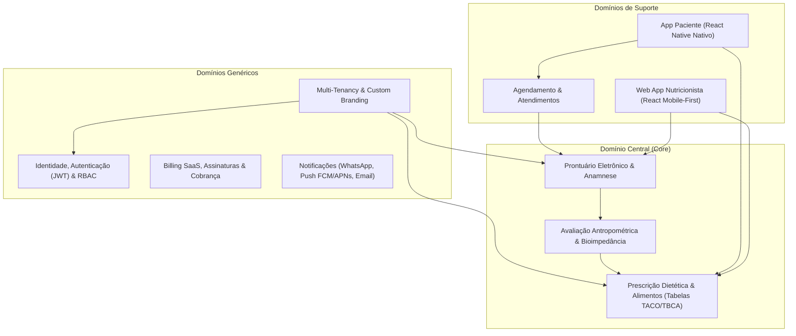
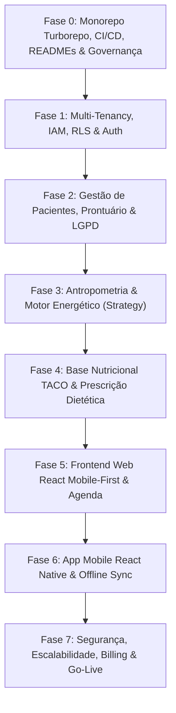

# YGEÍA (Υγεία) — Estudo de Arquitetura & Especificação Técnica

> **Ygeía (Υγεία)**: Do grego antigo *Saúde*. Plataforma SaaS White Label concebida para nutricionistas e clínicas nutricionais, focada no acompanhamento clínico, antropometria, prescrição dietética e relacionamento contínuo com pacientes.
>
> **Repositório Oficial**: [https://github.com/brunoemferreira/ygeia.git](https://github.com/brunoemferreira/ygeia.git)

---

## 1. Visão Executiva e Modelo de Negócio

### 1.1 Proposta de Valor
O **Ygeía** é um ecossistema digital B2B2C operando no modelo **SaaS White Label Multi-Tenant**:
- **Para o Nutricionista/Clínica (B2B)**: Redução drástica do tempo gasto na montagem de dietas, prontuário unificado em conformidade com o CFN (Conselho Federal de Nutricionistas) e LGPD, agenda integrada e fidelização de pacientes através de uma marca própria (White Label). Disponível tanto via Web com arquitetura **Mobile-First** (ideal para uso em consultório no desktop ou tablet/celular em atendimentos externos) quanto via app.
- **Para o Paciente (B2C)**: Acesso ao aplicativo nativo desenvolvido em **React Native** com a identidade visual da clínica/nutricionista, plano alimentar interativo, lista de compras dinâmica, diário alimentar fotográfico com câmera nativa e notificações push de hidratação e refeições.

### 1.2 Estratégia White Label e Multi-Tenancy
Para suportar múltiplos tenants (nutricionistas individuais ou clínicas multiprofissionais) com isolamento estrito de dados e personalização visual total:

| Camada | Estratégia Técnica | Descrição |
| :--- | :--- | :--- |
| **Isolamento de Dados** | **Discriminator Column (Tenant ID) com Row-Level Security (RLS) no PostgreSQL** | Excelente relação custo-benefício e facilidade operacional para centenas de tenants, com barreira de segurança imposta no nível do banco via RLS. |
| **Roteamento de Tenant** | **Subdomínios + Custom Domains** | Ex.: `drafulana.ygeia.app` ou domínio próprio `app.clinicanutri.com.br` gerenciado via Cloudflare for SaaS (SSL automático e proxy reverso). |
| **Identidade Visual Dinâmica** | **CSS Variables + Design Tokens + Bucket S3/R2 para Assets** | Logotipo, ícone, favicon, paleta primária/secundária/neutra injetadas em tempo de execução via CSS Variables dinâmicas na Web e Theme Context no React Native. |
| **Comunicação Transacional** | **White Label Emails & WhatsApp Gateway** | Emails de lembrete e PDFs de planos alimentares gerados com cabeçalho, rodapé e assinatura customizada do tenant. |

---

## 2. Arquitetura de Software: Clean Architecture & DDD

A aplicação segue a **Arquitetura Limpa (Clean Architecture / Hexagonal Architecture)** combinada aos conceitos do **Domain-Driven Design (DDD)**. O backend é concebido como um Monólito Modular desacoplado (Modular Monolith), preparado para evolução futura em microsserviços se a escala de domínios específicos exigir.

```
                           ┌────────────────────────────────────────┐
                           │           Frameworks & Drivers         │
                           │   (NestJS, Express, PostgreSQL, Redis) │
                           │  ┌──────────────────────────────────┐  │
                           │  │      Interface Adapters          │  │
                           │  │   (Controllers, Presenters,      │  │
                           │  │    Gateways, Repositories Impl)  │  │
                           │  │  ┌────────────────────────────┐  │  │
                           │  │  │      Application           │  │  │
                           │  │  │   (Use Cases, DTOs, CQRS)  │  │  │
                           │  │  │  ┌──────────────────────┐  │  │  │
                           │  │  │  │       Domain         │  │  │  │
                           │  │  │  │ (Entities, VOs,      │  │  │  │
                           │  │  │  │  Aggregates, Events, │  │  │  │
                           │  │  │  │  Domain Services)    │  │  │  │
                           │  │  │  └──────────────────────┘  │  │  │
                           │  │  └────────────────────────────┘  │  │
                           │  └──────────────────────────────────┘  │
                           └────────────────────────────────────────┘
                                     Regra de Dependência:
                                 (Externo aponta para Interno)
```

### 2.1 Bounded Contexts (Subdomínios do Negócio)



### 2.2 Estrutura do Monorepo e Documentação por Aplicação

O ecossistema utiliza um Monorepo gerenciado por **Turborepo** e **pnpm workspaces**, no qual **cada aplicação possui obrigatoriamente seu próprio `README.md` (instalação, execução, variáveis de ambiente, arquitetura interna) e seu respectivo `CHANGELOG.md`**:

```plaintext
ygeia/
├── README.md                         # Documentação Raiz do Ecossistema Ygeía
├── CHANGELOG.md                      # Histórico Global de Mudanças (SemVer)
├── package.json                      # Versão Única Central da Plataforma ("version": "x.y.z")
│
├── apps/
│   ├── api/                          # Backend NestJS (Fastify + TypeScript)
│   │   ├── README.md                 # Setup, Arquitetura, Endpoints, Migrations e Env Vars
│   │   ├── CHANGELOG.md              # Histórico de alterações da API
│   │   └── package.json
│   │
│   ├── web/                          # Frontend React (Mobile-First, Vite/Next.js + Tailwind)
│   │   ├── README.md                 # Setup, Guia de Mobile-First, Theming White Label e Env Vars
│   │   ├── CHANGELOG.md              # Histórico de alterações do Frontend Web
│   │   └── package.json
│   │
│   └── mobile/                       # App Mobile Nativo em React Native (Expo + TypeScript)
│       ├── README.md                 # Setup, Execução iOS/Android, Biometria, Offline e Builds
│       ├── CHANGELOG.md              # Histórico de alterações do Mobile
│       └── package.json
│
├── packages/
│   ├── domain-core/                  # Entidades de Domínio, VOs e Fórmulas Nutricionais
│   │   └── README.md
│   ├── api-client/                   # Cliente HTTP tipado com interceptors e suporte offline
│   │   └── README.md
│   ├── validation-schemas/           # Esquemas Zod compartilhados entre Back, Web e Mobile
│   │   └── README.md
│   ├── ui-tokens/                    # Cores, espaçamentos e design tokens do White Label
│   ├── eslint-config/                # Configurações de Linting compartilhadas
│   └── typescript-config/            # Configurações base do TypeScript
```

---

## 3. Diretrizes de Frontend Web: Arquitetura Mobile-First

O Frontend Web da plataforma Ygeía (utilizado por nutricionistas, secretárias e pacientes em navegadores) é construído sob a metodologia e as regras estritas de **Mobile-First Responsive Design**:

```
[ Layout Mobile (<640px) ]  ──►  [ Layout Tablet (640-1024px) ]  ──►  [ Layout Desktop (>1024px) ]
- Bottom Navigation Bar          - Sidebar Retrátil / Drawer           - Sidebar Fixa Expandida
- Floating Action Button (FAB)   - Grid de 2 Colunas                   - Grid Multi-Coluna / Bento
- Bottom Sheets Modais           - Modais Centralizados                - Painel Split-View (Prontuário)
- Cards Verticais Touch          - Tabelas Compactas com Scroll        - Tabelas de Alta Densidade
```

### 3.1 Regras de Implementação Mobile-First
1. **Estilização com Progressive Enhancement (Min-Width Media Queries)**:
   - Todo o CSS (Tailwind) é escrito iniciando pela visualização móvel: regras base sem prefixo afetam telas menores; prefixos `sm:`, `md:`, `lg:`, `xl:` adicionam complexidade visual conforme a viewport cresce.
2. **Touch Targets e Usabilidade Tátil**:
   - Elementos clicáveis/acionáveis possuem área mínima de toque de **48x48px** (conforme diretrizes da Apple HIG e Google Material Design) para operação ágil em smartphones e tablets.
   - Espaçamento adequado entre botões e inputs para evitar toques acidentais em procedimentos clínicos.
3. **Padrões de Navegação e Componentes Adaptativos**:
   - **Telas Pequenas (< 768px)**: Navegação primária via **Bottom Navigation Bar** e **Drawer**, ações secundárias em **Bottom Sheets** deslizáveis pelo polegar, e tabelas de dados convertidas automaticamente em **Data Cards Verticais**.
   - **Telas Grandes (>= 768px)**: Expansão fluida para sidebar fixa de alta densidade, tabelas de alimentos com filtros múltiplos e painéis lado a lado (*Split View* para prescrição simultânea à visualização do prontuário).
4. **Performance em Redes Móveis (3G/4G/5G)**:
   - Code-splitting e lazy loading por rota e componente (`React.lazy` + `Suspense`).
   - Imagens de alimentos e exames servidas com otimização em formatos modernos (**WebP/AVIF**) e tamanhos responsivos (`srcset`).
   - Tamanho do bundle inicial (First Load JS) rigorosamente mantido abaixo de 120 kB gzipped.

---

## 4. Engenharia Mobile: App Nativo em React Native

O aplicativo móvel voltado ao paciente (e posteriormente para o nutricionista em atendimentos remotos) é desenvolvido em **React Native** com **TypeScript**, garantindo desempenho nativo, acesso completo aos recursos de hardware e customização White Label dinâmica.

### 4.1 Tecnologias e Arquitetura do App Mobile
- **Core**: React Native 0.74+ com a **New Architecture (Fabric Renderer & TurboModules)** habilitada.
- **Workflow**: **Expo (Continuous Native Generation - CNG / Prebuild)**: Mantém o código TypeScript limpo, gerando os diretórios nativos `/ios` e `/android` sob demanda e permitindo o uso de bibliotecas nativas de ponta.
- **Navegação**: **React Navigation v6/v7** (Stack nativa para transições fluidas a 60/120 FPS e Bottom Tabs).
- **Gerenciamento de Estado & Cache**: **TanStack Query (React Query)** combinado a **Zustand** para estado leve em memória.
- **Offline-First & Persistência Local**:
  - **MMKV (react-native-mmkv)**: Armazenamento chave-valor ultra-rápido para temas e tokens.
  - **SQLite / WatermelonDB**: Armazenamento do plano alimentar em cache para que o paciente consulte suas refeições e registre ingestão de água mesmo **completamente sem internet**. Sincronização automática em background ao restabelecer conectividade.
- **Recursos Nativos Integrados**:
  - Câmera nativa para diário alimentar fotográfico.
  - Notificações Push nativas via **Firebase Cloud Messaging (FCM)** e **Apple Push Notification Service (APNs)**.
  - Haptics para feedback tátil em metas batidas.

---

## 5. Estrutura Tecnológica e Técnica para Alta Escalabilidade

Para suportar o crescimento sustentado da base de usuários (de centenas a centenas de milhares de nutricionistas e milhões de pacientes), o **Ygeía** adota uma arquitetura projetada para escalar horizontalmente em todas as camadas sem necessidade de reescrita estrutural.

```
                                  ┌────────────────────────┐
                                  │   Cloudflare CDN/WAF   │
                                  │ (Edge Cache, Anycast)  │
                                  └───────────┬────────────┘
                                              │
                         ┌────────────────────┴────────────────────┐
                         ▼                                         ▼
              ┌─────────────────────┐                   ┌─────────────────────┐
              │  API Gateway Pod 1  │                   │  API Gateway Pod N  │
              │  (NestJS + Fastify) │                   │  (NestJS + Fastify) │
              └──────────┬──────────┘                   └──────────┬──────────┘
                         │                                         │
        ┌────────────────┼─────────────────────────────────────────┼────────────────┐
        ▼                ▼                                         ▼                ▼
 ┌─────────────┐  ┌─────────────┐                           ┌─────────────┐  ┌─────────────┐
 │ L2 Cache    │  │ Filas Redis │                           │ PgBouncer   │  │ Workers Svc │
 │ Redis Clust.│  │ (BullMQ)    │                           │ Pool Conn.  │  │ (PDF/Push)  │
 └─────────────┘  └──────┬──────┘                           └──────┬──────┘  └─────────────┘
                         │                                         │
                         ▼                                         ▼
                  ┌─────────────┐                       ┌─────────────────────┐
                  │ Async Queue │                       │ PostgreSQL Primary  │
                  │ Processors  │                       │ (Escritas / ACID)   │
                  └─────────────┘                       └──────────┬──────────┘
                                                                   │ Replicação
                                                                   ▼
                                                        ┌─────────────────────┐
                                                        │ PostgreSQL Replica  │
                                                        │ (Leituras / TACO)   │
                                                        └─────────────────────┘
```

### 5.1 Escalabilidade da Camada de Aplicação (Stateless & Fastify Engine)
1. **Arquitetura 100% Stateless**: A API não guarda sessão em memória do processo. Toda autenticação e contexto de tenant residem em tokens JWT assinados ou no Redis compartilhado. Permite **Auto-Scaling Horizontal (HPA no Kubernetes/ECS)**.
2. **Alta Vazão com Fastify Adapter**: Throughput até 2.5x superior ao Express clássico, com consumo reduzido de CPU e memória sob alta concorrência.
3. **Graceful Shutdown & Health Checks**: `/health/live` e `/health/ready` integrados ao orquestrador.

### 5.2 Escalabilidade da Camada de Banco de Dados (PostgreSQL)
1. **Connection Pooling com PgBouncer**: Multiplexa milhares de conexões virtuais em um pool reduzido de conexões físicas no banco, evitando o esgotamento de conexões.
2. **Read/Write Splitting**: Mutações no nó Primary (Writer); leituras intensivas (pesquisas na base TACO/TBCA com mais de 3.000 itens e gráficos) distribuídas em Read Replicas.
3. **Particionamento de Tabelas Volumosas (RANGE Partitioning)**: Tabelas que acumulam milhões de registros (`audit_logs`, `patient_food_journal`, `water_intake_records`) são particionadas por mês/ano.
4. **Evolução de Multi-Tenancy (Sharding Híbrido)**: Modelo padrão via *Discriminator Column com RLS*, permitindo evolução transparente para *Dedicated Tenant Databases* para grandes redes e franquias.

### 5.3 Escalabilidade Assíncrona e Processamento em Background (Filas com BullMQ)
Processos computacionalmente pesados são enfileirados: geração de relatórios e cardápios em PDF, disparos de mensagens WhatsApp em lote e notificações push. Os workers escalam independentemente da API HTTP.

### 5.4 Estratégia de Cache Multi-Tier
- **L1 Cache (In-Memory Local LRU)**: Cache de 30s para resolução de host/tenant.
- **L2 Cache (Redis Cluster Distribuído)**: Cache de 1h a 24h para tabela TACO/TBCA e sessões ativas.
- **Edge Cache (Cloudflare CDN/R2)**: Entrega de fotos, exames e assets de layout próxima ao usuário.

### 5.5 Escalabilidade Organizacional: De Monólito Modular a Microsserviços
O backend inicia como um **Monólito Modular** com Bounded Contexts estritamente isolados. Se um módulo atingir requisitos extremos de throughput, ele poderá ser destacado para um **Microsserviço Independente** sem refatorar o domínio ou os casos de uso.

---

## 6. O Princípio YAGNI no Ygeía: Evitando a Sobre-Engenharia

O princípio **YAGNI** (*"You Aren't Gonna Need It"*) é a salvaguarda que impede o projeto de se perder em complexidade desnecessária antes do lançamento do MVP.

| Decisão | ❌ Armadilha (Violando YAGNI) |  Aplicação do YAGNI no Ygeía |
| :--- | :--- | :--- |
| **Arquitetura** | Iniciar com 8 microsserviços, gRPC, Istio e Kafka no Dia 1. | Iniciar com um **Monólito Modular** desacoplado em um único processo NestJS. |
| **Multi-Tenancy** | Criar provisionamento automático de bancos físicos isolados para os primeiros clientes. | Utilizar **PostgreSQL com Row-Level Security (RLS)** em banco único. |
| **Infraestrutura** | Cluster Kubernetes multi-região (EKS) complexo no primeiro deploy. | **Docker Compose** local e deploy em PaaS gerenciada (ECS, Railway ou VPS robusta). |
| **Base Nutricional** | Cadastrar 10 tabelas internacionais no primeiro sprint. | Começar com a **Tabela TACO (Unicamp)**, que cobre 95% das necessidades do Brasil. |
| **Fórmulas Energéticas** | Implementar 25 fórmulas matemáticas na primeira versão. | Começar com as 2 mais utilizadas: **Mifflin-St Jeor** e **Harris-Benedict**. |
| **Design Patterns** | Criar Abstract Factory, Visitor e Memento para CRUDs básicos. | Aplicar padrões **apenas onde a regra de negócio exige polimorfismo** (Strategy e Builder). |

---

## 7. Guia de Funcionamento do Frontend Web (React Mobile-First)

O aplicativo Web (`apps/web`) atende nutricionistas, secretárias, administradores de clínica e pacientes que acessam via navegadores de smartphones, tablets ou desktops.

```
┌────────────────────────────────────────────────────────────────────────┐
│                   FLUXO OPERACIONAL DO FRONTEND WEB                    │
├────────────────────────────────────────────────────────────────────────┤
│ 1. RESOLUÇÃO DE TENANT (Host Header / Subdomínio / Custom Domain)      │
│    └─► Fetch '/api/v1/tenants/branding'                                │
│    └─► Injeção no :root de CSS Variables (--primary, --font, logos)    │
│                                                                        │
│ 2. AUTENTICAÇÃO E SESSÃO                                               │
│    └─► Login com MFA TOTP para Nutricionistas                          │
│    └─► Refresh Token seguro em Cookie HttpOnly + Access Token Memory   │
│                                                                        │
│ 3. PAINEL CLÍNICO ADAPTATIVO (Mobile-First)                            │
│    ├─► Mobile (<768px): Bottom Bar, Drawer, Bottom Sheets, Cards Touch │
│    └─► Desktop (>=768px): Sidebar Fixa, Split-View Prontuário+Dieta    │
│                                                                        │
│ 4. PRESCRIÇÃO NUTRICIONAL                                              │
│    └─► Cálculo TMB/GET dinâmico (Strategy)                             │
│    └─► Busca instantânea na tabela TACO com debounce e cache local     │
│    └─► Distribuição de Macronutrientes em tempo real                   │
│    └─► Exportação de PDF com cabeçalho White Label                     │
└────────────────────────────────────────────────────────────────────────┘
```

### 7.1 Configurações e Inicialização
- **Variáveis de Ambiente (`.env`)**:
  - `VITE_API_URL` ou `NEXT_PUBLIC_API_URL`: URL base da API (`https://api.ygeia.app`).
  - `VITE_APP_DOMAIN`: Domínio raiz (`ygeia.app`).
- **Injeção Dinâmica de Marca (White Label Theming)**:
  - Ao carregar qualquer página, o provedor `TenantBrandingProvider` detecta o host e busca os tokens visuais.
  - Injeta dinamicamente no elemento `:root`:
    ```css
    :root {
      --color-primary: #10b981; /* Cor primária da clínica */
      --color-secondary: #064e3b;
      --font-family: 'Inter', sans-serif;
      --clinic-logo-url: url('https://cdn.ygeia.app/tenants/clinica-x/logo.png');
    }
    ```
- **Modos de Operação por Dispositivo**:
  - **No Smartphone do Nutricionista**: Interface compacta otimizada para atendimento em visitas ou consulta rápida de prontuário, com botões de ação fixos no rodapé (*Thumb Zone*).
  - **No Desktop do Consultório**: Layout expandido em *Split-View*: lado esquerdo exibe o histórico e anamnese do paciente, enquanto o lado direito permite montar a dieta e pesquisar alimentos em tempo real sem trocar de tela.

### 7.2 Fluxo de Utilização do Nutricionista
1. **Cadastro de Paciente**: Coleta de dados básicos, patologias pré-existentes e objetivos.
2. **Anamnese Estruturada**: Preenchimento de questionário com histórico alimentar, estilo de vida e exames anexados.
3. **Avaliação Antropométrica**: Inserção de peso, altura, circunferências e dobras cutâneas. O sistema calcula automaticamente o percentual de gordura e plota gráficos comparativos de evolução.
4. **Planejamento Dietético**:
   - Seleção da estratégia de gasto calórico (ex.: *Mifflin-St Jeor* para emagrecimento ou *Tinsley* para hipertrofia).
   - Montagem das refeições com alimentos da base TACO.
   - Ajuste de substitutos equivalentes por porção.
   - O paciente recebe instantaneamente a dieta em seu aplicativo móvel.

---

## 8. Guia de Funcionamento do Mobile (React Native)

O aplicativo móvel (`apps/mobile`) é desenvolvido nativamente em **React Native** com **TypeScript** e **Expo Bare / CNG**, projetado para o paciente acompanhar sua rotina e interagir com o nutricionista.

```
┌────────────────────────────────────────────────────────────────────────┐
│                   FLUXO OPERACIONAL DO APP MOBILE                      │
├────────────────────────────────────────────────────────────────────────┤
│ 1. DESCOBERTA DE TENANT & CUSTOM BRANDING                              │
│    └─► Opção A: Deep Link / QR Code recebido na consulta presencial    │
│    └─► Opção B: Inserção do slug da clínica (ex: 'clinica-vida')       │
│    └─► Download e persistência do tema em MMKV local                   │
│                                                                        │
│ 2. AUTENTICAÇÃO E BIOMETRIA                                            │
│    └─► Login com Magic Link ou Senha inicial                           │
│    └─► Ativação de Biometria Nativa (Face ID / Touch ID)               │
│    └─► Token armazenado no hardware (iOS Keychain / Android Keystore)  │
│                                                                        │
│ 3. ROTINA DIÁRIA DO PACIENTE (Offline-First)                           │
│    ├─► Visualização do Plano Alimentar do dia                          │
│    ├─► Notificações Push locais nos horários de cada refeição          │
│    ├─► Controle de Ingestão de Água (com feedback tátil haptics)       │
│    └─► Lista de Compras agregada da semana                             │
│                                                                        │
│ 4. DIÁRIO ALIMENTAR FOTOGRÁFICO                                        │
│    └─► Câmera nativa abre direto no app                                │
│    └─► Compressão local da foto em WebP (<300kB)                       │
│    └─► Upload imediato ou enfileiramento offline                       │
│                                                                        │
│ 5. PRIVACIDADE NATIVA                                                  │
│    └─► Privacy Screen ao alternar aplicativos no celular               │
└────────────────────────────────────────────────────────────────────────┘
```

### 8.1 Configuração e Compilação
- **Configuração no `app.json`**:
  - `expo.name`: Nome exibido do app (padrão Ygeía, substituível por build White Label dedicado se solicitado pelo cliente Enterprise).
  - `expo.scheme`: Deep link personalizado (`ygeia://clinica/:slug`).
- **Compilação de Binários**:
  - Gestão de builds via **EAS Build (Expo Application Services)**:
    - Android: Geração de binário `.aab` para a Google Play Store.
    - iOS: Geração de binário `.ipa` com perfis de provisionamento para TestFlight e App Store.

### 8.2 Mecanismo de Descoberta do Tenant no Primeiro Acesso
Quando o paciente baixa o aplicativo na loja:
1. **Ativação por QR Code ou Link**: O nutricionista imprime no rodapé da dieta ou envia via WhatsApp um link como `ygeia://join?clinic=drafulana`.
2. **Carregamento Instantâneo de Marca**: O app consulta a API, baixa a paleta de cores e o logotipo da clínica e grava no **MMKV**.
3. **Identidade Customizada**: A partir desse instante, a tela de splash, o cabeçalho, as cores dos botões e as notificações adotam a marca exclusiva da profissional.

### 8.3 Suporte Offline-First
- O aplicativo salva toda a prescrição alimentar ativa no **banco de dados SQLite local**.
- Se o paciente estiver no supermercado sem sinal 4G, ele consegue abrir a lista de compras e checar os alimentos substitutos sem erros de conexão.
- Ao registrar um copo d'água ou tirar a foto do prato de almoço sem internet, a ação é guardada na fila de sincronização local do MMKV e transmitida assim que a conexão retornar.

---

## 9. Mecânica de Negócio e Operação do SaaS White Label

O **Ygeía** funciona sob a ótica de uma plataforma B2B2C onde os assinantes pagantes são os nutricionistas/clínicas:

```
┌────────────────────────────────────────────────────────────────────────┐
│               JORNADA OPERACIONAL DO SAAS WHITE LABEL                  │
├────────────────────────────────────────────────────────────────────────┤
│ 1. ASSINATURA & ONBOARDING (B2B)                                       │
│    └─► Nutricionista escolhe plano (Starter / Pro / Clinic) na landing │
│    └─► Pagamento recorrente via Stripe / Asaas / Pagar.me              │
│    └─► Criação do Tenant no Postgres com ID único                      │
│                                                                        │
│ 2. PROVISIONAMENTO WHITE LABEL                                         │
│    └─► Tenant define slug ('clinicasaude') -> clinicasaude.ygeia.app   │
│    └─► (Opcional) Tenant insere CNAME próprio -> app.clinicasaude.com  │
│    └─► Cloudflare for SaaS emite certificado SSL automaticamente       │
│    └─► Upload de logotipo, favicon e seleção de paleta de cores        │
│                                                                        │
│ 3. OPERAÇÃO CLÍNICA DIÁRIA                                             │
│    └─► Atendimento de pacientes, emissão de planos alimentares         │
│    └─► Notificações transacionais de WhatsApp com nome da clínica      │
│                                                                        │
│ 4. ENGAJAMENTO DO PACIENTE (B2C)                                       │
│    └─► Paciente acessa Web ou Mobile com a marca da clínica contratada │
│    └─► Fidelização direta do paciente com o nutricionista              │
│                                                                        │
│ 5. GESTÃO DE CICLO DE VIDA DO SAAS                                     │
│    └─► Webhooks de pagamento processam renovação mensal                │
│    └─► Em caso de inadimplência: bloqueio suave após 5 dias de aviso   │
└────────────────────────────────────────────────────────────────────────┘
```

### 9.1 Níveis de Planos do SaaS
1. **Plano Starter (Nutricionista Individual)**:
   - Até 50 pacientes ativos.
   - Subdomínio White Label (`drfulano.ygeia.app`).
   - App do paciente com tema customizado.
2. **Plano Pro (Profissional Estabelecido)**:
   - Até 250 pacientes ativos.
   - Suporte a Domínio Próprio (`app.drfulano.com.br`) com SSL automático.
   - Notificações automáticas via WhatsApp Gateway.
3. **Plano Clinic (Clínicas e Franquias)**:
   - Pacientes ilimitados e múltiplos profissionais nutricionistas associados.
   - Perfis de secretárias/recepcionistas com RBAC restrito.
   - Relatórios gerenciais e faturamento financeiro integrado.

---

## 10. Stack Tecnológica Consolidada

| Camada | Tecnologia | Justificativa Técnica |
| :--- | :--- | :--- |
| **Linguagem Base** | **TypeScript 5.x** (Strict Mode) | Tipagem unificada de ponta a ponta (Back, Web Front e Mobile). |
| **Backend Framework** | **NestJS 10+ (Fastify Adapter)** | Arquitetura modular sólida, injeção de dependências e alta performance. |
| **Frontend Web** | **React 19 + TypeScript + Vite/Next.js** | Filosofia **Mobile-First**, Tailwind CSS, componentes acessíveis (Radix/Shadcn). |
| **Mobile App** | **React Native + Expo (CNG) + TypeScript** | Experiência nativa, New Architecture, offline-first, câmera e biometria nativas. |
| **Banco de Dados** | **PostgreSQL 16+ com RLS** | Robustez relacional, particionamento nativo, Read Replicas e suporte a RLS. |
| **Pooler de Conexões** | **PgBouncer / RDS Proxy** | Multiplexação de conexões para sustentar milhares de clientes simultâneos. |
| **Cache & Filas** | **Redis Cluster + BullMQ** | Rate limiting, revogação de tokens JWT, cache de tabelas de alimentos e filas de background. |
| **Acesso a Dados** | **Drizzle ORM ou Prisma** | Type-safety rigoroso, suporte nativo a migrações e consultas eficientes com RLS. |
| **Mídia e Documentos** | **AWS S3 / Cloudflare R2** | Armazenamento seguro de exames laboratoriais, fotos de evolução e PDFs de dietas. |
| **Proxy / Custom Domains** | **Cloudflare for SaaS** | Gerenciamento dinâmico de certificados SSL e roteamento de domínio próprio para clínicas. |

---

## 11. Arquitetura de Autenticação e Segurança

- **Access Token (15 min) + Refresh Token com Rotação (7 dias)**.
- **Detecção de Reuso de Refresh Token**: Invalidação imediata de toda a família de sessões do usuário no Redis se um token antigo for reusado.
- **MFA / 2FA Obrigatório via TOTP (RFC 6238)** para nutricionistas e administradores.
- **PostgreSQL Row-Level Security (RLS)**: Isolamento estrito de tenants no nível do banco via `current_setting('app.current_tenant_id')`.
- **Argon2id** para hashing de senhas.
- **Web**: Tokens de refresh em cookies **`HttpOnly`**, **`Secure`**, **`SameSite=Strict`**; access token estritamente em memória (sem armazenamento em `localStorage`).
- **Mobile**: Armazenamento seguro de credenciais via `expo-secure-store` (**iOS Keychain** e **Android Keystore**), **SSL Pinning**, **Autenticação Biométrica** nativa e **Privacy Screen** no alternador de tarefas do smartphone.
- **LGPD & CFN**: Classificação de dados de saúde como dados sensíveis (Art. 5º e 11) e cumprimento do prazo legal mínimo de guarda de prontuários por **5 anos** (Resolução CFN nº 599/2018).

---

## 12. Ciclo e Regra de Desenvolvimento Estrito

Toda e qualquer funcionalidade, refatoração ou correção a ser implementada na plataforma Ygeía **DEVE** seguir rigorosamente o pipeline de 6 estágios sequenciais:

```
┌─────────┐      ┌──────────────┐      ┌─────────────────┐
│ 1.PLANO │ ──►  │2.AUTORIZAÇÃO │ ──►  │3.DESENVOLVIMENTO│
└─────────┘      └──────────────┘      └─────────────────┘
                                                │
                                                ▼
┌──────────────────┐      ┌────────────────┐      ┌──────────┐
│ 6.PUBLICAÇÃO DEV │ ◄──  │5.VERSIONAMENTO │ ◄──  │ 4.TESTES │
└──────────────────┘      └────────────────┘      └──────────┘
```

1. **Plano**: Especificação detalhada da funcionalidade, impactos nas camadas (Domain, Application, Infra, Presentation), modelos e testes planejados.
2. **Autorização**: Validação e aprovação explícita do plano antes de qualquer linha de código de produção.
3. **Desenvolvimento**: Implementação com Clean Code, DDD, Design Patterns e Conventional Commits.
4. **Testes**: Execução de testes unitários, testes de integração e validação de regressão.
5. **Versionamento**: Bump da versão central no `package.json`, sincronização nos apps/pacotes, atualização dos `CHANGELOG.md` e commit semântico.
6. **Publicação para Testes do Dev**: Build e disponibilização no ambiente de preview/staging local para homologação prática pelo desenvolvedor antes do merge definitivo.

---

## 13. Estratégia de Versionamento Sincronizado e Documentação

### 13.1 Fonte Única da Verdade (`package.json`)
A plataforma Ygeía adota a estratégia de **Versionamento Sincronizado (Fixed/Locked Versioning)** para todo o ecossistema:
- A propriedade `"version"` no `package.json` da raiz é a **fonte única da verdade** da versão da plataforma (e.g., `1.0.0`).
- Um script automatizado (`pnpm version:sync`) sincroniza essa versão com:
  - `apps/api/package.json` (refletida no endpoint `GET /api/v1/health` e documentação Swagger).
  - `apps/web/package.json` (refletida no rodapé ou metadata da aplicação Web).
  - `apps/mobile/package.json`, bem como os campos nativos `expo.version`, `versionCode` (Android) e `buildNumber` (iOS) no `app.json`.

### 13.2 Padrão de Documentação por Aplicação (README.md e CHANGELOG.md)
Cada aplicação possui obrigatoriamente:
- **`README.md`**: Visão geral, pré-requisitos, instruções passo a passo de instalação e execução, tabela completa de variáveis de ambiente e arquitetura interna.
- **`CHANGELOG.md`**: Histórico cronológico estruturado conforme a especificação [Keep a Changelog](https://keepachangelog.com/), categorizado em `Adicionado`, `Modificado`, `Corrigido` e `Removido`.

### 13.3 Padrão de Commits: Conventional Commits v1.0.0
- Formato: `<type>(<scope>): <short description>`
- Tipos: `feat:`, `fix:`, `refactor:`, `test:`, `docs:`, `chore:`, `perf:`, `ci:`.
- Automação via **Husky** (`pre-commit` e `commit-msg`) e **Commitlint**.

---

## 14. Passo a Passo de Implementação (Roadmap Faseado)



### Fase 0: Setup do Monorepo, Documentação e Governança (✅ Concluída em 21/11/2026)
- [x] Inicialização do Monorepo com **Turborepo** e **pnpm workspaces**:
  - `apps/api`: Backend NestJS com Fastify.
  - `apps/web`: Frontend React (Mobile-First, Vite + Tailwind CSS + Shadcn/ui).
  - `apps/mobile`: Aplicativo React Native (Expo CNG + TypeScript).
  - `packages/domain-core`: Entidades e cálculos puros compartilhados (6/6 testes unitários passando).
  - `packages/validation-schemas`: Esquemas Zod compartilhados entre Back, Web e Mobile.
  - `packages/typescript-config`: Configurações base de TypeScript compartilhadas.
- [x] Criação dos arquivos `README.md` e `CHANGELOG.md` na raiz e dentro de cada aplicação (`api`, `web`, `mobile`).
- [x] Configuração do script de versionamento sincronizado via `package.json` (`scripts/sync-versions.ts`).
- [x] Configuração de Husky + Commitlint + Lint-Staged + Prettier (Conventional Commits v1.0.0).
- [x] Setup do Docker Compose local (PostgreSQL 16 com extensão UUID, Redis 7 com persistência).

### Fase 1: Multi-Tenancy, Autenticação e Segurança (IAM)
- [ ] Modelagem das tabelas `Tenants`, `TenantDomains`, `TenantBranding` e `Users`.
- [ ] Implementação de **Row-Level Security (RLS)** no PostgreSQL com `current_setting('app.current_tenant_id')`.
- [ ] Resolução de Tenant via Host header (subdomínios e domínios próprios) com `AsyncLocalStorage`.
- [ ] Módulo de Autenticação com Argon2id, JWT em cookies HttpOnly na Web e SecureStore no Mobile, detecção de reuso e MFA TOTP.
- [ ] Middleware com Helmet, Dynamic CORS para White Label e Rate Limiter (Throttler com Redis).

### Fase 2: Gestão de Pacientes e Prontuário Eletrônico
- [ ] Cadastro completo de pacientes, Anamnese Clínica modular com campos dinâmicos e Recordatório 24h.
- [ ] Anexos de exames laboratoriais criptografados em bucket S3/R2.
- [ ] Trilha de Auditoria imutável (`AuditLog`) registrando acessos e mutações de prontuário com particionamento temporal.

### Fase 3: Avaliação Antropométrica e Cálculos Energéticos
- [ ] Protocolos de dobras cutâneas: Jackson & Pollock (3 e 7), Petroski (4), Durnin & Womersley, Slaughter.
- [ ] Perímetros corporais, circunferências e dados de Bioimpedância.
- [ ] Implementação do **Strategy Pattern** para cálculo da Taxa Metabólica Basal (TMB):
  - Harris-Benedict (1919 e 1984), Mifflin-St Jeor, FAO/OMS, Tinsley, Cunningham.
- [ ] Gráficos comparativos de evolução corporal responsivos para Web e Mobile.

### Fase 4: Banco de Dados de Alimentos e Prescrição Dietética
- [ ] Carga e indexação da tabela **TACO** (Unicamp) com cache L2 em Redis.
- [ ] Módulo de Criação de Planos Alimentares (Meal Plan Builder) com cálculo de VET e macronutrientes em tempo real.
- [ ] Exportação assíncrona do plano em PDF estilizado automaticamente via fila BullMQ com branding do tenant.

### Fase 5: Frontend Web React (Mobile-First) e Agenda
- [ ] Design System Web baseado em Tailwind CSS e Shadcn/UI aplicando princípios **Mobile-First** (touch targets 48px, bottom sheets, split-view).
- [ ] Injeção dinâmica de CSS variables no `:root` com base no tenant ativo.
- [ ] Agenda do profissional com bloqueios de horários e autoagendamento público.

### Fase 6: Aplicativo Mobile em React Native
- [ ] Setup do app móvel com Expo Bare Workflow e TypeScript.
- [ ] Descoberta de Tenant via link/QR Code e persistência do tema em MMKV.
- [ ] Módulo de Dieta e Adesão do Paciente com **Suporte Offline** (SQLite/MMKV).
- [ ] Diário alimentar com captura fotográfica via câmera nativa e controle de água com haptics.
- [ ] Segurança Mobile: `expo-secure-store`, autenticação biométrica (Face ID/Fingerprint), Privacy Screen e SSL Pinning.

### Fase 7: Segurança, Escalabilidade, Billing & Go-Live
- [ ] Testes de carga e estresse (k6 / Artillery) para validação de escalabilidade da API e do PgBouncer.
- [ ] Módulo Financeiro SaaS (Billing dos Nutricionistas com Stripe / Asaas / Pagar.me).
- [ ] Pipeline CI/CD no GitHub Actions com builds automatizados Android/iOS via EAS Build.
- [ ] Auditoria de segurança, telemetria com OpenTelemetry e conformidade LGPD.

---

## 15. Exemplos Práticos de Código

### 15.1 Value Object: Macronutrientes (Compartilhado no Domínio Puro)
```typescript
// packages/domain-core/src/diet/value-objects/macronutrients.vo.ts
export class Macronutrients {
  private constructor(
    public readonly proteinGrams: number,
    public readonly carbohydrateGrams: number,
    public readonly fatGrams: number
  ) {
    this.validate();
  }

  public static create(protein: number, carbs: number, fat: number): Macronutrients {
    return new Macronutrients(protein, carbs, fat);
  }

  public get totalKcal(): number {
    return this.proteinGrams * 4 + this.carbohydrateGrams * 4 + this.fatGrams * 9;
  }

  private validate(): void {
    if (this.proteinGrams < 0 || this.carbohydrateGrams < 0 || this.fatGrams < 0) {
      throw new Error('Macronutrientes não podem possuir valores negativos.');
    }
  }
}
```

### 15.2 Strategy Pattern: Cálculo de Gasto Energético (TMB)
```typescript
// packages/domain-core/src/assessment/strategies/tmb-calculation.strategy.ts
export interface PatientBiometrics {
  weightKg: number;
  heightCm: number;
  ageYears: number;
  gender: 'MALE' | 'FEMALE';
  bodyFatPercentage?: number;
}

export interface ITmbCalculationStrategy {
  readonly name: string;
  calculate(biometrics: PatientBiometrics): number;
}

export class MifflinStJeorStrategy implements ITmbCalculationStrategy {
  readonly name = 'Mifflin-St Jeor (1990)';

  calculate(biometrics: PatientBiometrics): number {
    const { weightKg, heightCm, ageYears, gender } = biometrics;
    const base = 10 * weightKg + 6.25 * heightCm - 5 * ageYears;
    return gender === 'MALE' ? base + 5 : base - 161;
  }
}

export class HarrisBenedictStrategy implements ITmbCalculationStrategy {
  readonly name = 'Harris-Benedict (1984)';

  calculate(biometrics: PatientBiometrics): number {
    const { weightKg, heightCm, ageYears, gender } = biometrics;
    if (gender === 'MALE') {
      return 88.362 + 13.397 * weightKg + 4.799 * heightCm - 5.677 * ageYears;
    }
    return 447.593 + 9.247 * weightKg + 3.098 * heightCm - 4.330 * ageYears;
  }
}
```

### 15.3 React Native: Consumo Seguro de Sessão & Biometria Nativa
```typescript
// apps/mobile/src/services/auth-storage.service.ts
import * as SecureStore from 'expo-secure-store';
import * as LocalAuthentication from 'expo-local-authentication';

export class MobileAuthStorageService {
  private static readonly TOKEN_KEY = 'ygeia_auth_token';

  static async saveToken(token: string): Promise<void> {
    await SecureStore.setItemAsync(this.TOKEN_KEY, token, {
      keychainAccessible: SecureStore.AFTER_FIRST_UNLOCK,
    });
  }

  static async getTokenWithBiometrics(): Promise<string | null> {
    const hasHardware = await LocalAuthentication.hasHardwareAsync();
    const isEnrolled = await LocalAuthentication.isEnrolledAsync();

    if (hasHardware && isEnrolled) {
      const authResult = await LocalAuthentication.authenticateAsync({
        promptMessage: 'Autentique-se para acessar seu plano nutricional',
        fallbackLabel: 'Usar senha',
      });

      if (!authResult.success) {
        return null;
      }
    }

    return await SecureStore.getItemAsync(this.TOKEN_KEY);
  }
}
```

### 15.4 Script de Sincronização de Versão Centralizada (`package.json`)
```typescript
// scripts/sync-versions.ts
import fs from 'fs';
import path from 'path';

const rootPackageJson = JSON.parse(fs.readFileSync(path.resolve(__dirname, '../package.json'), 'utf8'));
const currentVersion = rootPackageJson.version;

console.log(`[YGEÍA] Sincronizando versão ${currentVersion} entre apps e pacotes...`);

const targetPackages = [
  'apps/api/package.json',
  'apps/web/package.json',
  'apps/mobile/package.json',
  'packages/domain-core/package.json',
];

targetPackages.forEach((pkgPath) => {
  const fullPath = path.resolve(__dirname, '..', pkgPath);
  if (fs.existsSync(fullPath)) {
    const pkg = JSON.parse(fs.readFileSync(fullPath, 'utf8'));
    pkg.version = currentVersion;
    fs.writeFileSync(fullPath, JSON.stringify(pkg, null, 2) + '\n');
    console.log(`  ✓ ${pkgPath} atualizado para ${currentVersion}`);
  }
});

// Sincroniza app.json do Expo (Mobile)
const appJsonPath = path.resolve(__dirname, '../apps/mobile/app.json');
if (fs.existsSync(appJsonPath)) {
  const appJson = JSON.parse(fs.readFileSync(appJsonPath, 'utf8'));
  appJson.expo.version = currentVersion;
  fs.writeFileSync(appJsonPath, JSON.stringify(appJson, null, 2) + '\n');
  console.log(`  ✓ apps/mobile/app.json atualizado para ${currentVersion}`);
}
```
