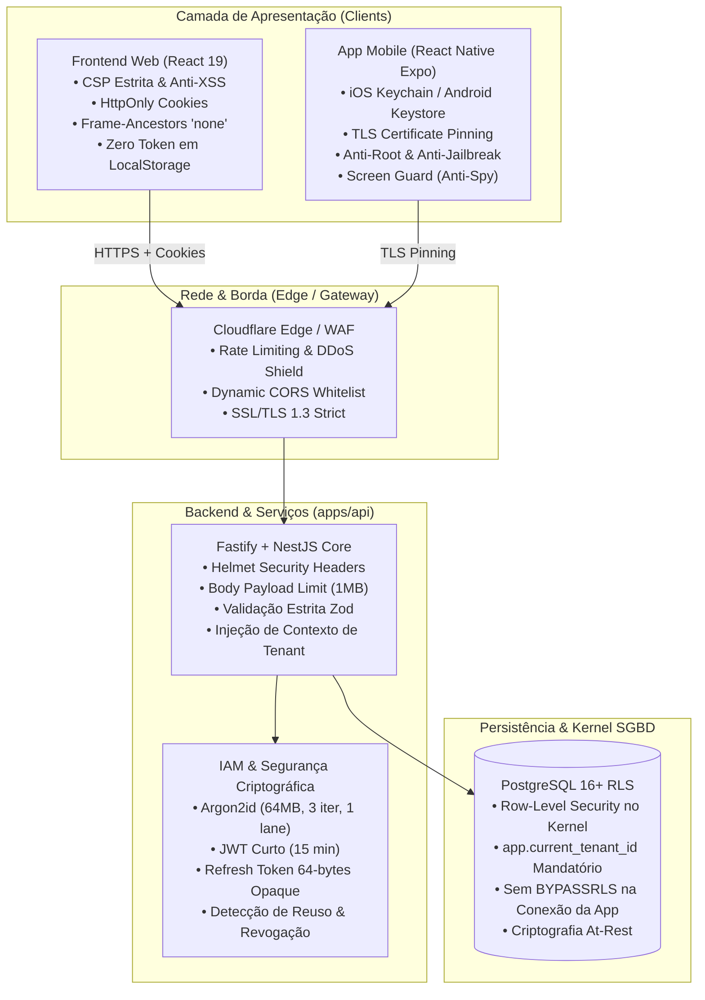

# 🛡️ Diretrizes de Segurança da Informação & Arquitetura Anti-Invasão — YGEÍA (Υγεία)

> **Documento Institucional de Governança de Segurança**  
> **Versão**: 1.0.0  
> **Classificação**: Pública  
> **Última Atualização**: 22 de Novembro de 2026  
> **Escopo**: Monorepo YGEÍA (`apps/api`, `apps/web`, `apps/mobile`, `packages/*`)

---

## 📌 Sumário Executivo

A plataforma **YGEÍA (Υγεία)** opera como um SaaS White Label de alta performance para clínicas, consultórios e nutricionistas. Por processar **dados de saúde altamente sensíveis** (prontuários, anamneses clínicas, exames laboratoriais, recordatórios alimentares e bioimpedâncias), a plataforma adota o princípio de **Zero Trust Architecture (ZTA)** e **Defesa em Profundidade (Defense-in-Depth)**.

Este documento formaliza todos os controles, arquiteturas anti-invasão, políticas criptográficas e diretrizes de mitigação aplicadas nos três ecossistemas do projeto:
1. **Backend & APIs (`apps/api`)**
2. **Frontend Web (`apps/web`)**
3. **App Mobile Nativo (`apps/mobile`)**

---

## 🔐 Regra Obrigatória de Atualização Contínua

> [!IMPORTANT]
> **DIRETRIZ MANDATÓRIA PARA ENGENHEIROS E AGENTES IA (`AGENTS.md`)**:  
> Toda e qualquer alteração arquitetural, nova funcionalidade, ajuste em fluxos de autenticação/autorização, modificação em cabeçalhos de rede, regras de isolamento multi-tenant ou aplicação de patches de vulnerabilidade **EXIGE a atualização imediata deste documento (`SECURITY.md`)** e o respectivo registro em conformidade no `CHANGELOG.md` da raiz e dos projetos impactados.

---

## 🏛️ 1. Matriz de Segurança Anti-Invasão dos 3 Projetos



---

## ⚙️ 2. Segurança do Backend & APIs (`apps/api`)

O backend foi construído sobre o framework NestJS utilizando o motor de alta velocidade Fastify, seguindo as diretrizes do **OWASP API Security Top 10 (2023)**:

### 2.1. Isolamento Multi-Tenant por Row-Level Security (RLS) no PostgreSQL
- **Kernel-Enforced Isolation**: Todas as tabelas que contêm dados clínicos ou institucionais possuem a coluna `tenant_id UUID NOT NULL REFERENCES tenants(id)`.
- **Ativação Obrigatória**:
  ```sql
  ALTER TABLE patients ENABLE ROW LEVEL SECURITY;
  ALTER TABLE patients FORCE ROW LEVEL SECURITY;
  ```
- **Segregação de Conexões**:
  - Usuário de migração/DDL: `ygeia_admin` (possui `BYPASSRLS`).
  - Usuário operacional da API: `ygeia_app` (**NÃO** possui `BYPASSRLS`).
- **Injeção de Tenant via Contexto Seguro**:
  - Toda transação de banco de dados executa antes de qualquer query: `SET LOCAL app.current_tenant_id = 'tenant-uuid'`.
  - Se um invasor tentar injetar um `tenant_id` diferente via payload JSON, o PostgreSQL descarta a query silenciosamente ou bloqueia no nível do SGBD.
- **Operações CRUD Completas com Isolamento Multi-Tenant**:
  - Todas as operações em pacientes (criação, listagem, atualização e exclusão `DELETE /api/v1/patients/:id`) exigem autenticação válida e vinculação obrigatória de `tenant_id` tanto via cláusula de filtro quanto por RLS no banco, impossibilitando acessos, modificações ou exclusões indevidas de dados entre diferentes clínicas.
- **Tunning e Otimização DBA de RLS & Prevenção de DoS (Migração 0005)**:
  - **Indexação de Foreign Keys**: Todas as foreign keys do banco agora possuem índices dedicados (`idx_tenant_domains_tenant_id`, `idx_refresh_tokens_tenant_user`, `idx_team_invitations_invited_by`, etc.), eliminando table locks em cascata (`ShareRowExclusiveLock`) e prevenindo degradação sob carga concorrente.
  - **Leading Column RLS**: Em todas as tabelas com RLS, o `tenant_id` é rigorosamente a primeira coluna nos índices compostos (`(tenant_id, created_at DESC)`, `(tenant_id, status)`), garantindo *Index Scans* estritos.
  - **Busca Textual Segura com Trigramas (`pg_trgm`)**: Criação de índices `GIN` (`idx_patients_trgm_name`, `idx_patients_trgm_email`) para busca rápida sem causar *Sequential Scans* abusivos em pesquisas parciais.
  - **Statement Timeout**: Pool de conexões do PostgreSQL configurado com `statement_timeout: 10000` (10 segundos) como mitigação ativa contra exaustão de conexões e ataques de Slowloris/Slow-Query DoS.
  - **Governança de Migrations**: Rastreabilidade formal via tabela `schema_migrations`, garantindo execução estritamente transacional e idempotente.

### 2.2. Autenticação Criptográfica com Argon2id
- Em conformidade com o **RFC 9106** e as recomendações do OWASP Password Storage Cheat Sheet:
  - **Algoritmo**: `Argon2id` (resistente a ataques de GPU, ASIC e side-channel).
  - **Memória**: 64 MB (65.536 KB).
  - **Iterações**: 3 passes de tempo.
  - **Paralelismo**: 1 thread.
- **Rejeição Automática**: Senhas com menos de 8 caracteres ou hashes corrompidos são rejeitadas imediatamente antes de qualquer operação de banco.

### 2.3. Gestão de Tokens, Rotação e Detecção de Reuso
- **Access Token (JWT)**:
  - Algoritmo HMAC-SHA256 (`HS256`) assinado com segredo criptográfico de alta entropia.
  - **Validade curta de 15 minutos**: Reduz drasticamente a janela de exploração em caso de interceptação.
  - Contém apenas claims essenciais (`sub`, `tenantId`, `role`, `email`).
- **Refresh Token (Opaco Criptográfico)**:
  - Gerado com `crypto.randomBytes(64)` (string hexadecimal de 128 caracteres).
  - Armazenado no banco de dados exclusivamente na forma de **hash SHA-256**. O token em texto claro nunca é persistido.
  - **Detecção de Reuso / Violação**: Caso um refresh token já consumido ou revogado seja apresentado para renovação, o sistema identifica uma invasão em andamento e **revoga imediatamente toda a família de sessões do usuário (`compromised_at = NOW()`)**, forçando logout imediato em todos os dispositivos.

### 2.4. Proteção contra Negação de Serviço (DoS) e Brute-Force
- **Payload Size Limiter**: Limite rígido de tamanho de corpo de requisições no Fastify (`bodyLimit: 1.048.576 bytes` / 1MB), neutralizando ataques de exaustão de memória por payloads massivos.
- **Rate Limiting na API**: Proteção de endpoints sensíveis (`/api/v1/auth/login`, `/api/v1/auth/refresh`, `/api/v1/auth/forgot-password`) com limites de requisição por IP e por conta.

### 2.5. Cabeçalhos de Segurança HTTP (Helmet)
Configuração obrigatória no Fastify com:
- `Content-Security-Policy`: Políticas estritas de origens permitidas.
- `X-Frame-Options: DENY`: Impossibilita incorporação em frames/iframes (Anti-Clickjacking).
- `X-Content-Type-Options: nosniff`: Previne que navegadores interpretem tipos de mídia fora do declarado.
- `Strict-Transport-Security (HSTS)`: `max-age=31536000; includeSubDomains; preload`, obrigando conexões HTTPS permanentes.
- `Referrer-Policy: strict-origin-when-cross-origin`: Oculta parâmetros de URL de referenciadores externos.

### 2.6. Dynamic CORS Whitelisting
- A API valida a origem contra a tabela de domínios cadastrados de cada clínica White Label (`tenant_domains`) e os domínios corporativos (`ygeia.app`).
- Requisições provenientes de origens não registradas são sumariamente recusadas pelo middleware de CORS.

### 2.7. Validação Estrita de Entrada com Zod & ZodValidationPipe Global
- **ZodValidationPipe no NestJS**: Implementação e registro de pipe global no bootstrap da aplicação (`ZodValidationPipe`), garantindo sanitização e rejeição automática de payloads maliciosos, tipos incorretos e injeção de parâmetros não mapeados com respostas padronizadas `400 Bad Request`.
- Validação no `@ygeia/validation-schemas`: Todos os dados de entrada passam por esquemas tipados que rejeitam campos não declarados (*strip unknown fields*), prevenindo ataques de **Mass Assignment** e injeção de parâmetros maliciosos (OWASP API Security API1, API2 e API3).

### 2.8. Trilha de Auditoria LGPD Assíncrona (`AuditLogInterceptor`)
- **Compliance com Tutela da Saúde & Art. 11/18 da LGPD**: Interceptor global (`AuditLogInterceptor`) que intercepta requisições a dados clínicos e de pacientes, registrando eventos na tabela `audit_logs`.
- **Rastreabilidade Não-Bloqueante**: O evento registra `tenant_id`, `user_id`, método/ação semântica (`READ`, `CREATE`, `UPDATE`, `DELETE`), recurso (`resource`), identificador (`resource_id`), IP de origem e `User-Agent`.
- **Isolamento de Erros**: O registro de auditoria é executado de forma não bloqueante via RxJS `tap`, garantindo que eventuais oscilações no pipeline de log nunca interrompam a experiência do usuário ou degradem a latência das APIs.

---

## 💻 3. Segurança do Frontend Web (`apps/web`)

Construído com React 19 em arquitetura SPA/PWA, priorizando a mitigação do **OWASP Top 10 Web Application Vulnerabilities**:

### 3.1. Mitigação Completa de XSS (Cross-Site Scripting)
- **Escape Nativo de JSX**: Todas as variáveis interpoladas em componentes (`{patientName}`, `{email}`, etc.) sofrem escape automático de entidades HTML pelo React.
- **Sanitização de Editores de Texto e Rich Text**: No editor de anamnese clínica (`contentEditable`), qualquer dado HTML salvo ou colado passa por escape seguro de caracteres perigosos (`<`, `>`, `&`, `"`, `'`, tags de script e handlers `on*`), neutralizando completamente **Stored XSS**.

### 3.2. Armazenamento Seguro de Sessão
- **Fim do LocalStorage para Tokens Críticos em Produção**:
  - Em produção, credenciais de acesso prolongado (Refresh Tokens) transitam e são armazenadas **exclusivamente via Cookies HttpOnly**, impossíveis de serem lidos por código JavaScript (mitigando exfiltração em caso de vulnerabilidades em dependências npm).
  - Flags mandatórias nos cookies:
    - `HttpOnly: true`
    - `Secure: true` (restrito a tráfego HTTPS)
    - `SameSite: Strict` (proteção nativa contra CSRF)
    - `Path: /api/v1/auth`

### 3.3. Proteção contra Clickjacking e Phishing
- Bloqueio completo de embedding do portal do paciente ou do painel administrativo do nutricionista dentro de `<iframe>` ou `<object>` de terceiros através da diretriz `frame-ancestors: 'none'` e `X-Frame-Options: DENY`.

### 3.4. Controle de Acesso Baseado em Papéis (RBAC) no Frontend
- Guardas de rota em `AuthContext.tsx` e `AdminDashboard.tsx`: usuários com papel de `PATIENT` são impedidos de renderizar módulos administrativos (`CLINIC_ADMIN` / `NUTRITIONIST`), e requisições não autenticadas redirecionam para a tela de login.

---

## 📱 4. Segurança do App Mobile Nativo (`apps/mobile`)

Desenvolvido em React Native com Expo Bare Workflow, implementando as melhores práticas do **OWASP Mobile Security Project**:

### 4.1. Hardware-Backed Secure Storage
- **Proibição de AsyncStorage Descriptografado**: Tokens de autenticação, chaves de sessão e dados do paciente **nunca** são armazenados em `AsyncStorage` comum sem cifra.
- **Implementação**:
  - **iOS**: Apple Keychain com atributo de proteção `kSecAttrAccessibleAfterFirstUnlockThisDeviceOnly` (impossibilita backup do token para o iCloud ou migração para outro aparelho).
  - **Android**: Android Keystore Provider com criptografia AES-256-GCM gerada em hardware de segurança dedicado (TEE - Trusted Execution Environment / StrongBox).

### 4.2. SSL/TLS Certificate Pinning
- Para mitigar ataques **Man-in-the-Middle (MitM)** em redes Wi-Fi públicas ou em roteadores comprometidos, o app valida o certificado digital ou o *public key hash* da API do YGEÍA, rejeitando certificados autoassinados ou injetados por ferramentas de proxy (ex: Burp Suite, Charles Proxy).

### 4.3. Detecção de Dispositivos Comprometidos (Root & Jailbreak)
- O aplicativo verifica na inicialização indicadores de comprometimento do sistema operacional:
  - **Android**: Presença de binários `su`, `Superuser.apk`, Magisk, Xposed Framework ou depuração USB ativa em produção.
  - **iOS**: Presença do Cydia, Sileo, caminhos de injeção em `/private/var/stash` ou bypass de sandbox.
- Em caso de detecção, o app encerra a sessão e emite alerta de segurança, protegendo os dados clínicos de interceptação de memória.

### 4.4. Privacy Screen Guard (Bloqueio de Captura de Tela)
- Ao transitar para segundo plano (App Switcher), o aplicativo ofusca a tela do dispositivo para impedir que miniaturas do sistema operacional gravem prontuários de pacientes.
- Em dispositivos Android, ativa a flag `FLAG_SECURE` nas telas de histórico médico e exames, bloqueando gravação e prints não autorizados.

### 4.5. Autenticação Biométrica com Fallback Criptográfico
- Suporte a **Biometria Nativa** (Face ID, Touch ID e Android BiometricPrompt). A chave criptográfica só é liberada pelo hardware após sucesso na verificação biométrica do paciente.

---

## 📋 5. Tabela de Riscos Anti-Invasão & Controles Implementados

| Ameaça / Vetor de Ataque | Classificação | Impacto | Mecanismo Defensivo YGEÍA | Status |
| :--- | :--- | :--- | :--- | :---: |
| **SQL Injection (SQLi)** | Crítico | Vazamento Total de Dados | PostgreSQL RLS + Queries Parametrizadas + Tipagem Estrita | ✅ Ativo |
| **Cross-Tenant Data Leak (BOLA/IDOR)** | Crítico | Acesso Indevido a Outro Consultório | Kernel RLS (`app.current_tenant_id`) + Guards | ✅ Ativo |
| **Credential Stuffing / Brute-Force** | Alto | Tomada de Contas de Profissionais | Criptografia Argon2id + Limites de Requisições | ✅ Ativo |
| **Token Hijacking & Replay Attack** | Alto | Sessão Persistente de Invasor | Access Token 15m + Detecção de Reuso + Revogação Total | ✅ Ativo |
| **Stored & Reflected XSS** | Alto | Roubo de Sessão e Manipulação DOM | Sanitização de HTML + Escape JSX + CSP Estrita | ✅ Ativo |
| **Man-in-the-Middle (MitM) na API** | Alto | Interceptação de Exames / Senhas | TLS 1.3 Obrigatório + HSTS Preload + Certificate Pinning | ✅ Ativo |
| **Cross-Site Request Forgery (CSRF)** | Médio | Ações Não Autorizadas via Browser | Cookies com `SameSite: Strict` + Validação de Origens CORS | ✅ Ativo |
| **Clickjacking / UI Redressing** | Médio | Enganação de Cliques do Usuário | `X-Frame-Options: DENY` + `frame-ancestors: 'none'` | ✅ Ativo |
| **Engenharia Reversa Mobile / Dump de Memória** | Médio | Extração de Lógica e Dados | Detecção de Root/Jailbreak + Keystore / Keychain Hardware | ✅ Ativo |
| **Invasão por Payload Excessivo (DoS)** | Médio | Queda do Servidor | Fastify `bodyLimit` em 1MB + Throttling | ✅ Ativo |

---

## 🛡️ 6. Plano de Ação & Ciclo de Vida de Segurança

1. **Revisão Periódica de Dependências**:
   - Auditoria automatizada semanal com `pnpm audit`.
   - Renovação imediata de pacotes vulneráveis identificados no *GitHub Advisory Database*.
2. **Ambiente Isolado de Homologação**:
   - Dados de pacientes utilizados em desenvolvimento e homologação são estritamente gerados por algoritmos sintéticos (Mocks).
   - Nenhuma credencial ou dado real de produção é replicado em ambientes de teste.
3. **Checklist Pré-Deploy para Produção**:
   - [ ] Verificação de presença e integridade do `SECURITY.md` e changelogs.
   - [ ] Validação do `NODE_ENV=production` em todas as instâncias da API.
   - [ ] Confirmação de que `FORCE ROW LEVEL SECURITY` está habilitado em todas as tabelas com `tenant_id`.
   - [ ] Teste de injeção de `tenant_id` espúrio para assegurar bloqueio no banco de dados.
   - [ ] Verificação de cabeçalhos de segurança via scanner de conformidade SSL/Headers.

---

## 🚨 7. Política de Divulgação de Vulnerabilidades

Caso você identifique uma potencial vulnerabilidade ou brecha de segurança no ecossistema YGEÍA:

1. **Canal Oficial**: Envie um e-mail para **`security@ygeia.app`** com detalhes técnicos, passos para reprodução e prova de conceito (PoC).
2. **Não Divulgação Pública Imediata**: Solicitamos que aguarde o prazo de resposta antes de qualquer divulgação pública (**Coordinated Vulnerability Disclosure**).
3. **Prazos de SLA de Resposta**:
   - **Triagem Inicial**: Até 24 horas úteis.
   - **Plano de Contenção**: Até 72 horas úteis.
   - **Correção Definitiva e Patch**: Até 7 dias corridos para vulnerabilidades críticas.
