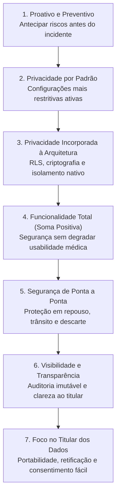
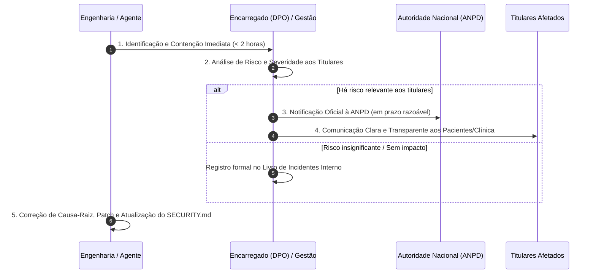

# Diretrizes de Desenvolvimento de Software para Conformidade com a LGPD
## YGEÍA (Υγεία) — Plataforma Clínica & Nutricional White Label

> **Documento Oficial de Engenharia e Governança de Privacidade**  
> **Fundamentação Legal**: Lei Geral de Proteção de Dados Pessoais (Lei nº 13.709/2018 — LGPD), Resoluções e Guias Oficiais da Autoridade Nacional de Proteção de Dados (ANPD — gov.br/anpd), Framework PPSI (Programa de Privacidade e Segurança da Informação do Governo Federal) e Resoluções Regulatórias do Conselho Federal de Nutricionistas (CFN nº 600/2018) e CFM (nº 1.821/2007).

---

## 1. Objetivo e Escopo

Este documento estabelece as diretrizes normativas e técnicas obrigatórias de arquitetura, desenvolvimento de software, modelagem de banco de dados e operação para todas as aplicações do ecossistema **Ygeía** (`apps/api`, `apps/web` e `apps/mobile`).

Todo desenvolvedor, engenheiro de software e agente de inteligência artificial atuando neste repositório **DEVE** cumprir integralmente este documento na concepção, implementação, refatoração e auditoria de qualquer funcionalidade do sistema.

---

## 2. Fontes Regulatórias Oficiais (ANPD & Legislação Federal)

As diretrizes deste documento foram compiladas diretamente das seguintes fontes governamentais e normativas:

1. **Lei nº 13.709/2018 (LGPD)**:
   - **Art. 6º**: Princípios fundamentais (Finalidade, Adequação, Necessidade, Livre Acesso, Qualidade dos Dados, Transparência, Segurança, Prevenção, Não Discriminação e Responsabilização).
   - **Art. 11**: Tratamento de **Dados Pessoais Sensíveis** (especificamente dados referentes à saúde, biometria e histórico alimentar).
   - **Art. 14**: Tratamento de dados pessoais de **Crianças e Adolescentes** (consentimento específico de pais ou responsável legal).
   - **Art. 18**: **Direitos do Titular** dos dados pessoais.
   - **Art. 46, § 2º**: Obrigatoriedade de medidas de segurança observadas **desde a fase de concepção do produto ou serviço até a sua execução** (*Privacy by Design* e *Privacy by Default*).
   - **Art. 48**: Comunicação e gestão de incidentes de segurança à ANPD e aos titulares.
2. **Guias Orientativos e Resoluções da ANPD (gov.br/anpd)**:
   - *Guia Orientativo de Segurança da Informação para Agentes de Tratamento de Pequeno Porte* (Resolução CD/ANPD nº 2/2022).
   - *Guia Orientativo: Hipóteses Legais de Tratamento de Dados Pessoais*.
   - *Guia de Boas Práticas: Privacidade desde a Concepção e por Padrão (Privacy by Design e by Default)* (PPSI / MGI / SGD).
   - *Guia Orientativo sobre Tratamento de Dados Pessoais de Crianças e Adolescentes*.
3. **Conselhos de Classe Profissional**:
   - **CFN nº 600/2018 e CFN nº 334/2004**: Sigilo profissional do nutricionista e integridade do prontuário nutricional.
   - **CFM nº 1.821/2007**: Temporalidade de guarda obrigatória de prontuários clínicos (mínimo de 20 anos em meio digital).

---

## 3. Classificação dos Dados no Ecossistema Ygeía

O Ygeía processa diferentes categorias de dados pessoais, com níveis de proteção e rigor técnico proporcional ao risco:

| Categoria | Definição LGPD | Exemplos no Ygeía | Base Legal Principal (LGPD) | Requisito Técnico Mínimo |
| :--- | :--- | :--- | :--- | :--- |
| **Dados Cadastrais Comuns** | Art. 5º, I | Nome completo, e-mail, telefone/WhatsApp, CPF, endereço, sexo atribuído, data de nascimento. | Execução de Contrato (Art. 7º, V) e Obrigação Legal (Art. 7º, II). | Criptografia em trânsito (TLS 1.3), hash de senhas Argon2id, controle de acesso RBAC. |
| **Dados Pessoais Sensíveis de Saúde** | Art. 5º, II e Art. 11 | Anamnese clínica, queixas, patologias preexistentes, histórico familiar, medidas antropométricas, bioimpedância, dobras cutâneas, exames laboratoriais, recordatórios alimentares, alergias e intolerâncias. | **Tutela da Saúde** em procedimento realizado por profissional de saúde (Art. 11, II, "f") ou Consentimento Específico e Destacado (Art. 11, I). | **Kernel-Enforced RLS** no PostgreSQL, auditoria imutável de leitura/gravação, segregação multi-tenant, mascaramento em logs. |
| **Dados de Menores (Crianças e Adolescentes)** | Art. 14 | Dados de pacientes menores de 18 anos submetidos a acompanhamento nutricional pediátrico. | Consentimento específico e em destaque dado por pelo menos um dos pais ou responsável legal (Art. 14, § 1º). | Campo obrigatório de nome e CPF do responsável legal (`guardian_name`, `guardian_cpf`), registro do consentimento. |
| **Dados de Autenticação & Sessão** | Art. 46 | Senhas, refresh tokens, chaves 2FA (TOTP), tokens de reset. | Segurança e Prevenção à Fraude (Art. 11, II, "g"). | Criptografia irreversível com sal e custo computacional (Argon2id), hashes SHA-256 de refresh tokens, cookies `HttpOnly`, `Secure` e `SameSite=Strict`. |
| **Dados de Trilha de Auditoria** | Art. 46 | IP de conexão, User-Agent, carimbo de data/hora (TIMESTAMPTZ), ID do operador, recurso acessado. | Cumprimento de Obrigação Legal e Responsabilização (Art. 6º, X e Art. 16, I). | Armazenamento seguro segregado com RLS, retenção mínima de 6 meses (Marco Civil da Internet, Art. 15). |

---

## 4. Os 7 Princípios do *Privacy by Design* no Ygeía

Seguindo as diretrizes oficiais de *Privacidade desde a Concepção e por Padrão*, a engenharia do Ygeía adota:



1. **Proativo, não reativo; preventivo, não corretivo**: A segurança não é tratada como "patch" pós-vazamento. Toda modelagem de banco e endpoints nasce blindada.
2. **Privacidade como Configuração Padrão (*Privacy by Default*)**:
   - Ao criar uma conta ou paciente, o perfil nasce com o máximo de privacidade possível ativado.
   - Compartilhamento de dados externos e notificações opcionais exigem *opt-in* voluntário.
3. **Privacidade Incorporada ao Design**: A proteção faz parte do código (Row-Level Security no PostgreSQL, validação estrita com Zod, middleware de tenant).
4. **Funcionalidade Total (Soma Positiva, não Soma Zero)**: Não há compensação prejudicial entre privacidade e usabilidade clínica. O nutricionista tem agilidade na consulta mantendo o sigilo integral.
5. **Segurança de Ponta a Ponta durante todo o Ciclo de Vida**: Da coleta na anamnese até o eventual arquivamento/descarte após o prazo legal.
6. **Visibilidade e Transparência**: O paciente e o nutricionista têm clareza sobre quais dados foram coletados e quem teve acesso.
7. **Respeito pela Privacidade do Usuário**: Facilidades de exportação dos dados (portabilidade) e exercício pleno de seus direitos.

---

## 5. Diretrizes Práticas de Desenvolvimento de Software

### 5.1. Minimização de Dados (*Data Minimization* — Art. 6º, III)
- **Regra**: Colete estritamente o necessário para a finalidade dietoterápica.
- **Prática**:
  - Proibido criar campos no formulário de paciente que não possuam justificativa clínica ou fiscal (ex: não solicitar religião, orientação política ou dados financeiros do paciente quando desnecessários à conduta nutricional).
  - Campos não essenciais para o cálculo nutricional devem ser expressamente marcados como opcionais (`(opcional)`).

### 5.2. Isolamento Multi-Tenant Estrito no Kernel do Banco de Dados
- **Regra**: Jamais depender exclusivamente de cláusulas `WHERE tenant_id = ...` na camada de aplicação.
- **Prática**:
  - Toda tabela que armazena dados de pacientes, prontuários, anamneses ou recordatórios **DEVE** ter Row-Level Security ativado e forçado:
    ```sql
    ALTER TABLE patients ENABLE ROW LEVEL SECURITY;
    ALTER TABLE patients FORCE ROW LEVEL SECURITY;
    ```
  - A conexão da aplicação (`ygeia_app`) **NÃO PODE** possuir privilégio `BYPASSRLS`.
  - Toda transação deve injetar o tenant via `SET LOCAL app.current_tenant_id = '...'`.
  - O `tenant_id` deve ser a primeira coluna em qualquer índice composto.

### 5.3. Proibição de `SELECT *` e Exposição Excessiva de Dados (OWASP API3:2023)
- **Regra**: Nunca retornar objetos de banco crus para o frontend ou para logs.
- **Prática**:
  - Endpoints de listagem devem retornar apenas os campos necessários para a grade ou tabela (DTOs explícitos).
  - Dados sensíveis como senhas, chaves 2FA, tokens e anotações médicas confidenciais nunca devem constar em respostas públicas ou de busca simplificada.
  - O uso de `SELECT *` em produção é estritamente proibido.

### 5.4. Higienização de Logs e Prevenção de Vazamento em Telemetria
- **Regra**: Dados pessoais sensíveis de saúde **NUNCA** devem ser gravados em logs de servidor, logs de console (`console.log`) ou rastreadores de erro (ex: Sentry/Datadog).
- **Prática**:
  - Mascarar CPFs (`***.456.789-**`), senhas e tokens antes de emitir qualquer log.
  - Sanitizar corpos de requisição (`req.body`) de rotas sensíveis como `/auth/login`, `/patients` e `/anamnese` para remover conteúdos clínicos de payloads de depuração.

### 5.5. Criptografia em Trânsito e em Repouso
- **Em Trânsito**:
  - Obrigatoriedade de HTTPS com TLS 1.3 / TLS 1.2 com cifras seguras.
  - Habilitação do cabeçalho HSTS (`Strict-Transport-Security: max-age=31536000; includeSubDomains; preload`).
  - WebSockets autenticados exclusivamente sobre WSS.
- **Em Repouso**:
  - Senhas hasheadas obrigatoriamente com **Argon2id** (64MB memória, 3 iterações, 1 thread).
  - Tokens de autenticação persistidos como hash SHA-256 determinístico.
  - Dados de armazenamento em nuvem (S3/Cloud Storage) protegidos com criptografia do lado do servidor (SSE-AES256 ou SSE-KMS).

### 5.6. Trilha de Auditoria Obrigatória (`audit_logs`)
- **Regra**: Todo acesso de leitura ou gravação a dados sensíveis de saúde deve gerar registro de auditoria para garantir rastreabilidade perante a ANPD e os Conselhos de Classe.
- **Campos Obrigatórios**:
  - `tenant_id`: Identificador da clínica.
  - `user_id`: Identificador do usuário que realizou a ação.
  - `action`: Ex: `READ_PRONTUARIO`, `UPDATE_ANAMNESE`, `EXPORT_DATA`, `DELETE_RECORD`.
  - `resource`: Ex: `PATIENT`, `CLINICAL_NOTE`, `DIET_PLAN`.
  - `resource_id`: ID do registro afetado.
  - `ip_address`: Endereço IP anonimizado ou protegido.
  - `created_at`: Data e hora com fuso (`TIMESTAMPTZ`).

---

## 6. Implementação dos Direitos do Titular (Art. 18 da LGPD)

O software deve dispor de mecanismos nativos para permitir que o nutricionista e o paciente exerçam seus direitos previstos em lei:

### 6.1. Confirmação de Existência e Acesso aos Dados (Art. 18, I e II)
- O paciente tem o direito de visualizar todos os dados cadastrais e o histórico clínico mantidos sob sua titularidade através do aplicativo ou de solicitação ao consultório.

### 6.2. Correção de Dados Incompletos, Inexatos ou Desatualizados (Art. 18, III)
- O sistema deve fornecer interfaces ágeis e auditadas de edição de cadastro e histórico para retificação imediata.

### 6.3. Portabilidade dos Dados (Art. 18, V)
- O Ygeía deve disponibilizar funcionalidade de exportação completa do prontuário do paciente em formato interoperável e aberto:
  - **Formato Estruturado**: JSON / CSV.
  - **Formato Legível**: Relatório impresso em PDF contendo o histórico antropométrico, anamnese e planos alimentares.

### 6.4. Eliminação dos Dados vs. Guarda Obrigatória de Prontuários (Art. 16 e Art. 18, VI)
- > [!IMPORTANT] **Harmonização Regulatória (LGPD vs. CFN/CFM)**:
  - O direito de eliminação de dados de saúde **NÃO É ABSOLUTO**.
  - O Art. 16, I da LGPD expressamente autoriza a conservação de dados pessoais para **cumprimento de obrigação legal ou regulatória pelo controlador**.
  - As normas sanitárias e as Resoluções do CFN e CFM exigem a guarda do prontuário por no **mínimo 20 (vinte) anos** a contar do último atendimento.
- **Implementação Técnica no Software**:
  - Quando um paciente solicitar a exclusão de sua conta:
    1. **Dados de Marketing / Comunicação**: Imediatamente apagados (`welcome_email = false`, cancelamento de avisos).
    2. **Prontuário Clínico**: O paciente é desativado (`status = 'ARCHIVED'` ou `'INACTIVE'`), anonimizando credenciais de acesso mas preservando o registro clínico lacrado e imutável para resguardo profissional e cumprimento do prazo legal de 20 anos.

---

## 7. Dados de Menores de Idade (Crianças e Adolescentes — Art. 14)

1. **Consentimento Específico e em Destaque**:
   - Para pacientes menores de 18 anos, o sistema exige obrigatoriamente o preenchimento de `guardian_name` (Nome do Responsável) e `guardian_cpf` (CPF do Responsável).
2. **Uso Proporcional**:
   - Dados de menores jamais serão utilizados para qualquer finalidade secundária que não seja o acompanhamento nutricional e a saúde do menor.

---

## 8. Vedação de Compartilhamento Discriminatório (Art. 11, § 4º)

- É **terminantemente proibida** a comunicação ou o uso compartilhado entre controladores de dados pessoais sensíveis referentes à saúde com objetivo de obter vantagem econômica, salvo na prestação de serviços de saúde ou assistência farmacêutica.
- **Arquitetura Anti-Vazamento**:
  - O código do Ygeía é auditado para garantir que nenhuma biblioteca de telemetria externa, pixel de rastreamento (Facebook Pixel, Google Analytics com User-ID, etc.) ou script de terceiros tenha acesso a dados de saúde ou nomes de pacientes.

---

## 9. Plano de Resposta a Incidentes de Segurança com Dados Pessoais (Art. 48)

Todo evento adverso (suspeita de acesso indevido, vazamento, indisponibilidade prolongada ou ataque cibernético) deve seguir o fluxo de resposta:



1. **Contenção Imediata**: Bloqueio de tokens, isolamento de rotas, rotação de chaves e bloqueio de IPs atacantes.
2. **Avaliação**: O Encarregado de Proteção de Dados (DPO) avalia a natureza dos dados afetados e o volume.
3. **Notificação à ANPD e aos Titulares**: Conforme determina o Art. 48 da LGPD quando o incidente puder acarretar risco ou dano relevante aos titulares.

---

## 10. Checklist Obrigatório de Desenvolvimento (DoD — Definition of Done)

Antes de aprovar qualquer Pull Request, commit ou entrega de funcionalidade, o desenvolvedor/agente deve checar:

- [ ] **Minimização**: Todos os novos campos coletados são estritamente necessários para o atendimento clínico?
- [ ] **Isolamento Multi-Tenant**: O `tenant_id` está presente e validado por Row-Level Security no PostgreSQL?
- [ ] **Proteção de Dados Sensíveis**: Campos clínicos estão protegidos contra exposição desnecessária em APIs?
- [ ] **Ausência de Dados Pessoais em Logs**: Não há gravação de nomes, CPFs, e-mails ou anamneses no console ou arquivos de log?
- [ ] **Auditoria Ativa**: Operações de criação, visualização, edição ou exclusão de dados clínicos disparam evento na tabela `audit_logs`?
- [ ] **Sanitização de Inputs**: Todas as entradas do usuário passam por validação estrita (Zod schemas / NestJS DTOs)?
- [ ] **Prevenção de SQL Injection**: Consultas utilizam parâmetros tipados (`$1, $2`), sem concatenação crua de strings?
- [ ] **Tratamento de Menores**: Se aplicável, os campos de responsável legal foram coletados e validados?
- [ ] **Atualização de Documentação**: `SECURITY.md`, `CHANGELOG.md` e guias foram devidamente atualizados?
