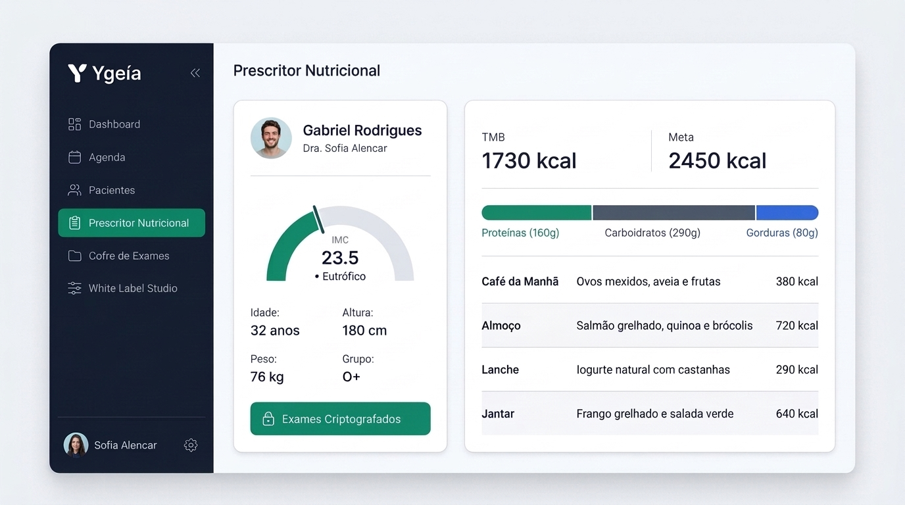
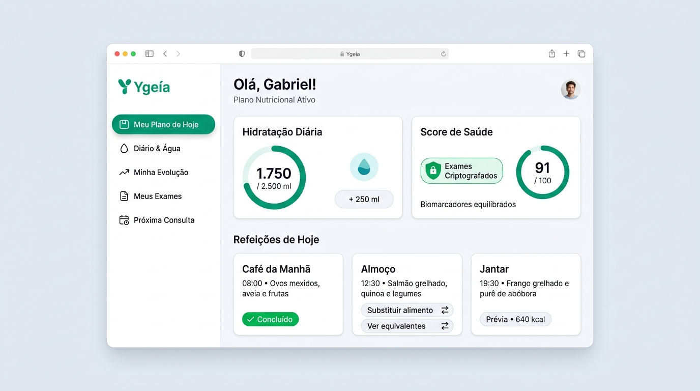
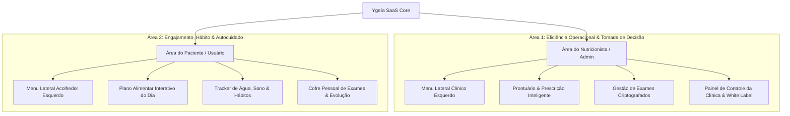
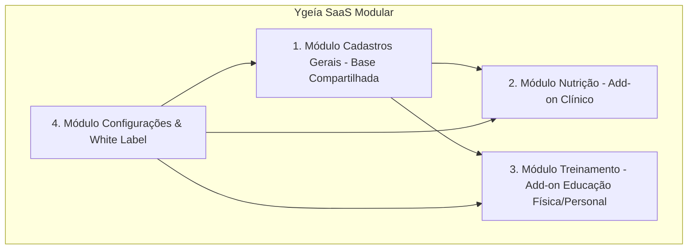

# 📐 Estudo de UX/UI Design — Plataforma YGEÍA (Υγεία)
**Autor:** Senior UX & Product Designer (10+ anos em HealthTech & B2B SaaS)  
**Versão:** 1.0.0 • **Data:** 21/11/2026  
**Status:** Proposta de Arquitetura de Informação & Design System para Validação

---

## 1. Visão Geral & Desafio de Produto

O **Ygeía** é uma plataforma SaaS White Label de alta performance para nutrição de precisão. O ecossistema frontend é composto por duas experiências profundamente distintas, mas visualmente integradas sob o motor de **White Label dinâmico**:

### Imagens de Referência Conceitual de Alta Fidelidade

- **Área do Nutricionista (Workspace Clínico Split-Screen)**:
  

- **Área do Paciente (Portal de Hábitos, Hidratação & Cardápio Interativo)**:
  



---

## 2. Personas & Heurísticas de Usabilidade

### 🩺 Persona 1: A Nutricionista / Gestora da Clínica (Dra. Sofia Alencar)
- **Perfil:** Especialista atarefada, realiza entre 6 a 12 consultas/dia. Alterna rapidamente entre análise de exames, elaboração de cardápios e gestão do consultório.
- **Dores Principais:** Perda de tempo preenchendo prontuários burocráticos; ferramentas lentas com muitos cliques; tabelas nutricionais confusas; software genérico que não valoriza a marca da clínica.
- **Necessidade UX:** **Densidade de informação com clareza (High Information Density)**, navegação por atalhos de teclado (estilo Linear/Raycast), comandos rápidos (Cmd+K), split-screen (ver prontuário e prescrever refeição simultaneamente) e zero fricção.

### 🍎 Persona 2: O Paciente / Usuário Final (Gabriel Rodrigues)
- **Perfil:** 29 anos, rotina corrida, busca hipertrofia e saúde digestiva. Usa o portal tanto no notebook quanto no celular.
- **Dores Principais:** Planos alimentares em PDF estáticos e difíceis de ler no mercado; esquecimento de hidratação e suplementação; desmotivação quando não sabe o que substituir em uma refeição.
- **Necessidade UX:** **Design Acolhedor & Gamificado (Low Cognitive Load)**, visual limpo estilo Apple Health, ações em 1 toque (marcar refeição realizada, registrar copo d'água), visualização clara de substituições de alimentos autorizadas e acesso seguro e simplificado aos seus laudos laboratoriais.

---

## 3. Arquitetura do Menu Lateral Esquerdo (Sidebar)

Ambas as áreas utilizam um **Menu Lateral Esquerdo (Collapsible Left Sidebar)** fixo, com comportamento retrátil inteligente:

| Estado da Sidebar | Largura | Comportamento & Feedback Visual |
| :--- | :--- | :--- |
| **Expandida (Padrão Desktop)** | `260px` | Exibe logo White Label, ícone, rótulo da seção, badges numéricas e atalhos rápidos de teclado. |
| **Recolhida (Modo Foco)** | `72px` | Exibe apenas os ícones com tooltips flutuantes instantâneos no hover e indicadores de status. |
| **Mobile Drawer (Telas < 1024px)**| `100% overlay` (280px drawer) | Abre suavemente via botão de hambúrguer ou gesto de swipe com backdrop blur escurecido. |

---

## 4. Estrutura Detalhada: Área do Nutricionista & Treinador (Admin SaaS Modular)

Como muitos profissionais atuam tanto na Nutrição quanto na Educação Física (ou clínicas contam com equipe multidisciplinar), a plataforma adota uma **Arquitetura Modular em 4 Grandes Blocos**, permitindo que cada módulo seja ativado/vendido de forma independente ou em pacote integrado:



### 4.1. Hierarquia de Navegação da Sidebar Modular (Nutricionista / Treinador)

> [!IMPORTANT]
> **Regra de Licenciamento & Governança Estrita de Menus**:
> - **Módulos `Cadastros` e `Configurações`**: **SEMPRE HABILITADOS** para todos os clientes, pois formam a fundação do sistema.
> - **Módulo `Nutrição`**: Liberado apenas se a licença incluir nutrição.
> - **Módulo `Treinamento`**: Liberado apenas se a licença incluir treinamento.
> - **Escopo Imutável**: Nunca misturar atribuições entre os menus. Dados biométricos compartilhados (peso, dobras, bioimpedância, exames) pertencem exclusivamente a **Cadastros**. Prescrição alimentar pertence a **Nutrição**. Fichas de treino e periodização pertencem a **Treinamento**.

```
[TOP: Identidade da Clínica & Seletor de Tenant]
├── [🏢 Logo White Label da Clínica / Studio]
└── [Badge: "Módulos Ativos: Nutrição + Treinamento"]

━━━━━━━━━━━━━━━━━━━━━━━━━━━━━━━━━━━━━━━━━━━━━━━━━━━━━━━━━
1. MÓDULO CADASTROS GERAIS (Base Compartilhada Universal)
━━━━━━━━━━━━━━━━━━━━━━━━━━━━━━━━━━━━━━━━━━━━━━━━━━━━━━━━━
├── 👥 Pacientes & Alunos (CRM unificado, prontuário, tags, status de adesão)
├── 📅 Agenda & Sessões (Consultas nutricionais e treinos presenciais/online)
├── 📐 Avaliação Física & Antropometria (Dobras cutâneas, bioimpedância, perímetros, fotos)
└── 🔒 Cofre de Exames & Laudos (AES-256, exames bioquímicos, ergoespirometria, atestados)

━━━━━━━━━━━━━━━━━━━━━━━━━━━━━━━━━━━━━━━━━━━━━━━━━━━━━━━━━
2. MÓDULO NUTRIÇÃO (Especialidade Clínica & Diética)
━━━━━━━━━━━━━━━━━━━━━━━━━━━━━━━━━━━━━━━━━━━━━━━━━━━━━━━━━
├── 🥗 Prescritor Nutricional (Planos alimentares, TMB/GET, divisão de macronutrientes)
├── 🥦 Tabela TACO & Alimentos (Banco Unicamp, IBGE e alimentos personalizados da clínica)
├── 📖 Biblioteca de Receitas & Orientações (Receitas saudáveis, e-books e substituições)
└── 💊 Suplementação & Fitoterapia (Prescrições com fórmulas manipuladas e timbrado)

━━━━━━━━━━━━━━━━━━━━━━━━━━━━━━━━━━━━━━━━━━━━━━━━━━━━━━━━━
3. MÓDULO TREINAMENTO (Educação Física & Performance)
━━━━━━━━━━━━━━━━━━━━━━━━━━━━━━━━━━━━━━━━━━━━━━━━━━━━━━━━━
├── 🏋️ Prescritor de Treinos (Fichas de musculação A/B/C/D, séries, repetições, RIR, RPE)
├── 🎬 Banco de Exercícios (Vídeos de execução, grupos musculares, equipamentos)
├── 📈 Periodização & Volume (Controle de sobrecarga progressiva, volume semanal e 1RM)
└── 🏃 Cardio & Treinamento Aeróbio (Zonas de frequência cardíaca, HIIT, testes de esteira)

━━━━━━━━━━━━━━━━━━━━━━━━━━━━━━━━━━━━━━━━━━━━━━━━━━━━━━━━━
4. MÓDULO CONFIGURAÇÕES & SAAS
━━━━━━━━━━━━━━━━━━━━━━━━━━━━━━━━━━━━━━━━━━━━━━━━━━━━━━━━━
├── 🎨 White Label Studio (Identidade visual, logos, paleta de cores, tipografia e domínio)
├── 🏢 Dados da Clínica / Consultório (CNPJ, razão social, endereço físico, WhatsApp)
├── 🩺 Registros Profissionais (CRN do nutricionista e/ou CREF do educador físico)
├── 👥 Equipe & Permissões RBAC (Nutricionistas, Treinadores, Administradores, Recepção)
└── 📦 Planos & Módulos Ativos (Gerenciamento das licenças: Nutrição / Treino)

[BOTTOM: Perfil do Profissional Logado]
├── [Avatar + Nome do Profissional (CRN-3 / CREF-SP)]
└── [Alternância de Tema Claro/Escuro & Logout]
```

---

## 5. Estrutura Detalhada: Área do Paciente (Portal do Usuário)

### 5.1. Hierarquia de Navegação da Sidebar (Paciente)
```
[TOP: Clínica Responsável]
├── [Logo da Clínica do Nutricionista - White Label Puro]
└── [Status: "Paciente Ativo de Dra. Sofia Alencar"]

[BLOCO 1: ROTINA & HÁBITOS DE HOJE]
├── 🍽️ Meu Plano Alimentar (Cardápio interativo do dia, receitas, substituições)
├── 💧 Diário de Hábitos (Tracker de água com metas em ml, registro fotográfico)
└── 💊 Minha Suplementação & Manipulados (Horários programados e dosagens)

[BLOCO 2: MINHA SAÚDE & EVOLUÇÃO]
├── 📈 Minha Evolução (Gráficos de peso, medidas corporais, fotos antes/depois)
├── 🔒 Meus Exames Laboratoriais (Histórico criptografado de marcadores sanguíneos)
└── 📋 Minhas Prescrições & PDFs (Receituários oficiais e atestados assinados)

[BLOCO 3: COMUNICAÇÃO & SUPORTE]
├── 📅 Próxima Consulta & Agendamento (Data, horário e link de telemedicina)
└── 💬 Falar com a Nutricionista (Chat seguro para dúvidas sobre refeições)

[BOTTOM: Perfil do Paciente]
├── [Avatar + Gabriel Rodrigues]
└── [Configurações da Conta & Sair]
```

---

## 6. Sistema Visual & Design Tokens (Modern Clinical Glass)

| Elemento | Especificação Técnica | Aplicação |
| :--- | :--- | :--- |
| **Biblioteca de Ícones SVG** | `lucide-react` (com `strokeWidth={1.5}` ou `1.75`) | Ícones ultra-limpos, vetoriais puros, sem ruído visual. |
| **Tipografia Principal** | `Plus Jakarta Sans` (300, 400, 500, 600, 700, 800) | Títulos, menus, botões e corpo do texto. |
| **Tipografia de Dados** | `JetBrains Mono` / `SF Mono` | Valores numéricos, dosagens, calorias, peso, marcadores de exames. |
| **Fundo da Aplicação** | `#f8fafc` (Slate 50) com ambient lighting | Evita cansaço visual em jornadas de trabalho clínico longas. |
| **Superfícies (Cards)** | `#ffffff` com `backdrop-filter: blur(12px)` e borda `#e2e8f0` | Aspecto premium, limpo, sem sombras pesadas. |
| **Cores Primárias** | Dinâmicas via CSS Variables `--tenant-primary` | Injetadas pelo banco multi-tenant da clínica. |
| **Cores de Alerta Clínico** | Sucesso (`#059669`), Alerta (`#d97706`), Perigo (`#dc2626`), Info (`#0284c7`) | Status de exames, conformidade calórica e avisos de sigilo. |

### Catálogo de Ícones SVG Oficiais (`lucide-react`):
- **Nutricionista / Admin:** `LayoutDashboard`, `Calendar`, `Users`, `UtensilsCrossed`, `ShieldCheck`, `Scale`, `FileText`, `Activity`, `Palette`, `Building2`, `Stethoscope`, `Settings`.
- **Paciente / Portal:** `Utensils`, `Droplets`, `Pill`, `TrendingUp`, `Lock`, `CalendarCheck`, `MessageCircleHeart`, `HeartPulse`.
